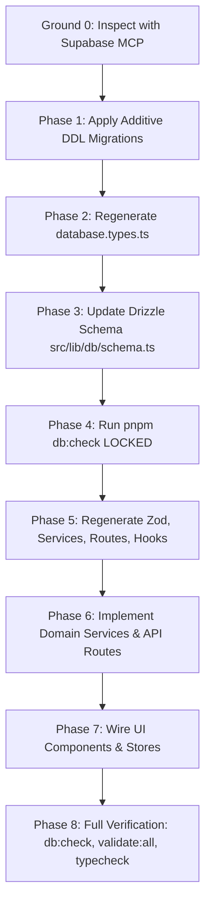

# Build Prompt — Wire Newly Migrated Sections to Backend

**Goal.** Provide the master implementation plan and technical roadmap for wiring all newly migrated `-new` front-end surfaces (now running at their cutover canonical URLs on `movemental.ai`) to the live backend through our seven-tier type safety chain.

**Governing Documents:**
- [docs/architecture/TYPE_SAFETY_CHAIN.md](../../architecture/TYPE_SAFETY_CHAIN.md) — The seven-tier type safety chain, Supabase MCP integration, and schema-change waterfall.
- [docs/type/README.md](../../type/README.md) — Layer guides and lock-before-proceed validation commands.
- [MIGRATION-NEW-STATE.md](../../../MIGRATION-NEW-STATE.md) — The post-cutover migration status ledger.

---

## 1. Inventory of Newly Migrated Sections & Backend Wiring Status

| Slice | Canonical Route | Front-End Status | Backend Status | Dedicated Build Prompt |
|-------|-----------------|------------------|----------------|------------------------|
| **S02** | `/resolve` (+ `/document`, `/people`, `/others`, `/r/[token]`) | Live (cutover) | **Device storage only** (`draft.ts` fixture seam) | [wire-resolution-to-backend.md](./wire-resolution-to-backend.md) |
| **S07** | `/assessment` (+ `/predict`, `/answer`, `/results`) | Live (cutover) | **Component state only** (`questions.ts` fixture seam) | [wire-reality-assessment-to-backend.md](./wire-reality-assessment-to-backend.md) |
| **S06** | `/work-with-us/inquire` | Live (cutover) | **Fully wired** via `src/app/api/contact/route.ts` & `contact_submissions` table | [wire-capture-and-enrollment-to-backend.md](./wire-capture-and-enrollment-to-backend.md) |
| **S01** | `/` (Home) | Live (cutover) | Fully wired navigation & routes | Completed |
| **S03** | `/map`, `/map/[stage]` | Live (cutover) | Links to `/resolve/people` (waits on S02) | Completed |
| **S04** | `/guidebook`, `/guidebook/[chapter]` | Live (cutover) | Chapter reading interface | Content milestone |
| **S05** | `/leaders`, `/leaders/[slug]` | Live (cutover) | File-backed research corpus | Content milestone |
| **S08** | `/churches`, `/nonprofits`, `/institutions` | Live (cutover) | Dynamic portal routes pointing to S02 & S07 | Completed |
| **S09** | `/about`, `/story` | Live (cutover) | Static narrative | Completed |

---

## 2. Priority 1: The Resolution Surface (`/resolve`)

**Detailed Prompt:** [docs/build/prompts/wire-resolution-to-backend.md](./wire-resolution-to-backend.md)

### Key Capabilities to Wire
1. **Durable Resolution Storage:** Move from `localStorage` in `draft.ts` to `resolutions` and `resolution_versions` tables in Supabase Postgres.
2. **Passwordless Magic Link:** Save and resume drafts via email link.
3. **Revocable Share Links (`/r/[token]`):** Secure unlisted/public links with token revocation.
4. **Colleague Invitations:** Disseminate team invites via email with unique tokens.
5. **The 5-Contributor Privacy Rule:** Enforce at the database query level that `/resolve/people` returns no aggregated theme/role selections until 5 or more members have submitted.

---

## 3. Priority 2: The Reality Assessment (`/assessment`)

**Detailed Prompt:** [docs/build/prompts/wire-reality-assessment-to-backend.md](./wire-reality-assessment-to-backend.md)

### Key Capabilities to Wire
1. **Session Lifecycle:** Start form creates session with organization name & leader email.
2. **Leader Prediction Sealing:** 8 Youthfront Likert predictions sealed and isolated from contributor view.
3. **Anonymous Contributor Answers:** `/assessment/answer?token={token}` records candid 8-question feedback.
4. **Live Contributor Waiting Room:** Polled / realtime counter on the waiting screen ("X of 5 required to unseal").
5. **Reality Gap Analysis:** Dynamically compute and display the alignment gap once 5 or more responses are collected.

---

## 4. Execution Sequence & Dependency Order



1. **Step 1:** Execute DDL migrations for Resolution and Assessment tables via Supabase MCP.
2. **Step 2:** Run `npx -y supabase gen types typescript --db-url "$DATABASE_URL" --schema public > src/lib/supabase/database.types.ts`.
3. **Step 3:** Declare the tables in `src/lib/db/schema.ts` and verify with `pnpm db:check`.
4. **Step 4:** Regenerate the five code layers:
   ```bash
   pnpm generate:schemas && pnpm contracts:check
   pnpm generate:services && pnpm services:check
   pnpm generate:routes && pnpm routes:check
   pnpm generate:hooks && pnpm hooks:check
   ```
5. **Step 5:** Implement specialized domain endpoints under `src/app/api/resolve/` and `src/app/api/assessment/`.
6. **Step 6:** Wire the client UI components (`draft.ts`, `assessment-views.tsx`) to consume the React Query hooks.
7. **Step 7:** Run `pnpm validate:all` and `pnpm typecheck` to verify complete compile-time correctness with zero errors.
